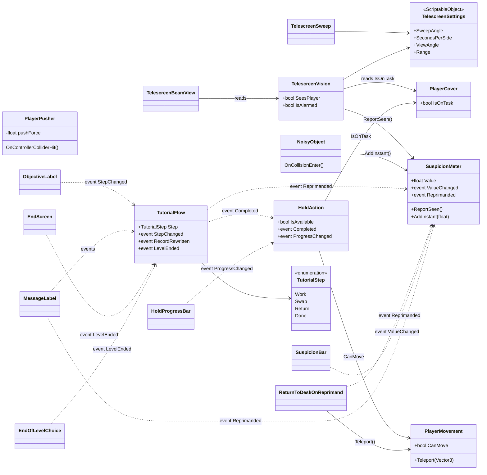

# WATTching: tutorial level, code architecture

## 1. Folders (by responsibility)

```
Assets/
├── Scripts/
│   ├── Player/        PlayerMovement, PlayerPusher, PlayerCover
│   ├── Hazards/       TelescreenSettings, TelescreenSweep, TelescreenVision, TelescreenBeamView, NoisyObject
│   ├── Interaction/   HoldAction
│   ├── Systems/       SuspicionMeter, ReturnToDeskOnReprimand
│   ├── Flow/          TutorialFlow, TutorialStep, EndOfLevelChoice
│   └── UI/            SuspicionBar, HoldProgressBar, ObjectiveLabel, MessageLabel, EndScreen
├── Data/              Telescreen_Standard.asset   (TelescreenSettings)
├── Materials/
├── Scenes/            TutorialScene
└── Prefabs/
```

## 2. One sentence per class (Single Responsibility)

Each sentence is written without "and", per the course's test.

| Class | Responsibility |
|---|---|
| `PlayerMovement` | Moves the player on the floor with a CharacterController. |
| `PlayerPusher` | Pushes Rigidbodies the player walks into. |
| `PlayerCover` | Tells observers whether the player is doing approved work right now. |
| `TelescreenSettings` | Holds the tuning data for one kind of telescreen. |
| `TelescreenSweep` | Swings the telescreen left and right like a pendulum. |
| `TelescreenVision` | Reports the player to the suspicion meter when it sees them off-task. |
| `TelescreenBeamView` | Draws the vision cone on the floor. |
| `NoisyObject` | Raises suspicion when the object is slammed into something. |
| `HoldAction` | Completes an action after the player holds the interact button in a zone. |
| `SuspicionMeter` | Tracks how suspicious the regime is of the player. |
| `ReturnToDeskOnReprimand` | Sends the player back to the desk when reprimanded. |
| `TutorialFlow` | Runs the tutorial's steps toward a win or a loss. |
| `SuspicionBar`, `HoldProgressBar` | Show a value as a bar. |
| `ObjectiveLabel`, `MessageLabel` | Show the current objective / short story messages. |
| `EndScreen` | Shows the win or arrest screen. |
| `EndOfLevelChoice` | Carries out the player's choice after the level ends (play again / quit). |

## 3. Communication

**Rule: game code never references UI.** The UI subscribes to C# `event`s. Every `+=` in `OnEnable` has a matching `-=` in `OnDisable`. There are no singletons and no static state.

| Event | Raised by | Listened to by |
|---|---|---|
| `HoldAction.Completed` | HoldAction | TutorialFlow |
| `HoldAction.ProgressChanged(float)` | HoldAction | HoldProgressBar |
| `SuspicionMeter.ValueChanged(float)` | SuspicionMeter | SuspicionBar |
| `SuspicionMeter.Reprimanded(int)` | SuspicionMeter | ReturnToDeskOnReprimand, TutorialFlow, MessageLabel |
| `TutorialFlow.StepChanged(TutorialStep)` | TutorialFlow | ObjectiveLabel, MessageLabel |
| `TutorialFlow.RecordRewritten(int, int)` | TutorialFlow | MessageLabel |
| `TutorialFlow.LevelEnded(bool)` | TutorialFlow | EndScreen, EndOfLevelChoice |

**Direct calls that remain, and why:**
- `TelescreenVision → SuspicionMeter.ReportSeen()` / `NoisyObject → SuspicionMeter.AddInstant()`: these are game-to-game commands ("count this"), not notifications. An event would just add indirection here.
- `HoldAction → PlayerMovement.CanMove / PlayerCover.IsOnTask`: the zone directly controls the player who is inside it.
- `TutorialFlow → HoldAction.IsAvailable`: the level rules decide when the locker can be used.

## 4. Data separate from logic

- Telescreen tuning (sweep angle, timing, cone width, range) lives in a **ScriptableObject** asset (`TelescreenSettings`) in `Assets/Data`.
- All other tuning values are `[SerializeField]` Inspector fields: speeds, push force, suspicion fill/drain times, hold times, records to rewrite, reprimands before arrest, and every UI text.
- The only numbers left in code are named constants that describe geometry, such as `StandingOnThreshold = 0.7f`.

## 5. UML class diagram

Rendered automatically on GitHub. Arrows labelled `event` are subscriptions (the listener knows the source; the source doesn't know the listener).



## 6. Example change for the presentation: "a new kind of hazard"

**A faster, wider telescreen for a harder room.**
1. `Assets/Data` → Create → WATTching → Telescreen Settings → `Telescreen_Fast.asset`: sweep 3 s per side, cone 40°.
2. Duplicate the Telescreen object, drag `Telescreen_Fast` into its Sweep and Vision.

**Files changed: zero.** Only a new data asset was added. This works because:
- the numbers live in data, not code (section 4);
- every telescreen reports to the same `SuspicionMeter`, which already merges any number of observers (`ReportSeen` sets a per-frame flag, so two screens seeing you don't double-count);
- the UI listens to the meter, so it doesn't care how many screens exist.

**A different behavior (e.g., a patrolling inspector):** one new script, `InspectorPatrol` (movement only). For sight it reuses `TelescreenVision` (renaming that class to `Observer` would make the reuse clearer). Nothing existing changes.

## 7. Deviations and notes (for the AI-review log)

- **Lose condition:** the tutorial design doc says the tutorial is never a game over. The course requires a working win/lose condition, so `TutorialFlow.reprimandsBeforeArrest` (default 3) ends in an arrest screen. Set it to 0 to restore the design doc's behavior.
- **Code review by AI:** this structure was produced with Claude (Anthropic). Record that in the usage log, and review the code against this diagram before submitting.
