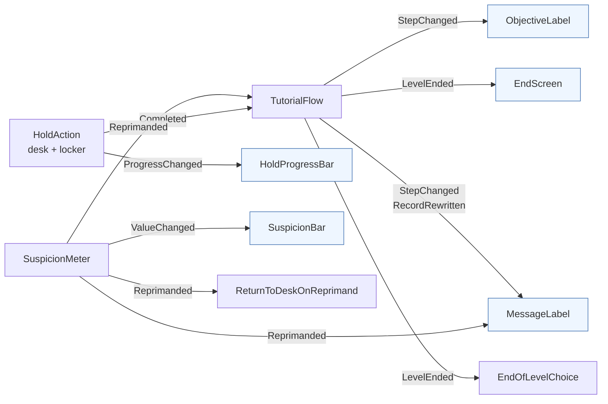
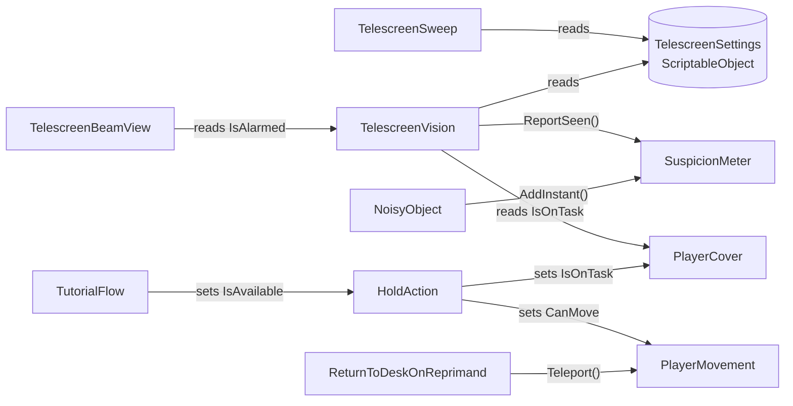

# WATTching

**Oceania, 1984.** You are a clerk at the Ministry of Truth. Do your job, stay out of the telescreen's sight, and quietly sabotage the regime from inside.

This repository contains the **tutorial level**: one room, one telescreen, and the full core loop of *work as cover → wait → cross → sabotage → return*.

▶ **Play in the browser:** [itch.io page](ITCH_LINK_HERE)  ·  **Design docs:** [`Docs/`](Docs/)

---

## How to play

1. **Work:** hold **E** at your desk to rewrite 3 records. Working is your cover: the telescreen ignores you while you work.
2. **Swap:** a slip arrives. Sneak to the archive (east door) and hold **E** at the locker for 5 s.
3. **Return:** go back to your desk and work once more to restore your cover.

The telescreen sweeps like a pendulum. Its cone turns **red** when it sees you off-task, and your suspicion meter fills. Hide behind the pillar, wait for the beam to swing away, then cross. Don't slam the mail cart into walls: the noise is suspicious too.

**Win:** finish the swap and return to work. **Lose:** get reprimanded 3 times and you are arrested.

| Action | Keyboard | Gamepad |
|---|---|---|
| Move | WASD / Arrow keys | Left stick |
| Work / swap (hold) | E | A / Cross |
| Play again (end screen) | E | A / Cross |
| Quit (built game only) | Esc | |

## How to run the project

- **In the browser:** the itch.io link above (no install needed).
- **In Unity:**
  1. Clone the repo: `git clone https://github.com/kohaku-inu/WATTching.git`
  2. Open the folder in **Unity Hub** with **Unity 6.3 LTS (6000.3.25f1)**. Packages, including the Input System, install automatically on the first open.
  3. Open `Assets/Scenes/TutorialScene` and press **Play**. Click inside the Game view once so it receives keyboard input.

## Class relationships

Scripts are grouped by responsibility in `Assets/Scripts/`: `Player/`, `Hazards/`, `Interaction/`, `Systems/`, `Flow/`, `UI/`. Tuning data lives in `Assets/Data/`.

**Events (sender → receiver).** Game scripts announce what happened; receivers subscribe. The sender never knows who is listening.

Blue = UI scripts (`Assets/Scripts/UI/`). They only receive; nothing in the game logic references them.

**Direct references (caller → called).** Used only where one game script commands or reads another.

`PlayerPusher` has no arrows because it talks to Unity's physics only: it calls `AddForce` on any Rigidbody the player walks into. A full UML class diagram with fields and methods is in [`Docs/ARCHITECTURE.md`](Docs/ARCHITECTURE.md) ([image](Docs/UML_class_diagram.png)).

**Rules the code follows:** game code never references UI code; every event subscription in `OnEnable` is removed in `OnDisable`; each class has one responsibility, describable in one sentence without "and".

## Architecture decisions

**1. Events from game to UI, instead of direct references.**
*Chosen:* game scripts raise C# events (`SuspicionMeter.ValueChanged`, `TutorialFlow.StepChanged`, …) and UI scripts subscribe to them.
*Alternative:* `SuspicionMeter` holds a reference to the slider and updates it directly.
*Why:* the game logic works and can be tested with no UI in the scene, and the UI can be redesigned, or a second display added, without touching game code. An early version did use direct references and was refactored.

**2. Several small components instead of one large class.**
*Chosen:* the telescreen is three components: `TelescreenSweep` (rotation), `TelescreenVision` (detection) and `TelescreenBeamView` (drawing). The player is likewise split into `PlayerMovement`, `PlayerPusher` and `PlayerCover`.
*Alternative:* one `Telescreen` class that does all three.
*Why:* each part can change alone. A different movement pattern replaces only the sweep, and a moving guard could reuse `TelescreenVision` unchanged.

**3. A ScriptableObject for telescreen tuning, instead of numbers on each object.**
*Chosen:* sweep angle, timing, cone width and range live in a `TelescreenSettings` asset.
*Alternative:* `[SerializeField]` fields on every telescreen.
*Why:* a "type" of telescreen becomes a reusable asset. Changing the asset updates every screen that uses it, and a new difficulty needs no code. Values that belong to a single object (walk speed, hold time) stay as Inspector fields.

## Adding a new hazard or item

| Change | Files that change | Why only those |
|---|---|---|
| **A faster / wider telescreen** | None. Create a new `TelescreenSettings` asset in `Assets/Data/` and assign it to a duplicated telescreen | Numbers are data. Every telescreen reports to the same `SuspicionMeter`, which merges any number of observers, and the UI only listens to the meter |
| **A patrolling inspector** (new enemy type) | **New:** `Hazards/InspectorPatrol.cs` (movement only). Reuse `TelescreenVision` on the same object for sight | Seeing and reporting already exist as their own component; only the new behavior (moving) is new code |
| **A new noisy object** (e.g. a chair) | None. Add a `Rigidbody` + `NoisyObject` to any object | `NoisyObject` doesn't know what it is attached to |
| **A new hold-to-use station** | None for the action itself: add a trigger + `HoldAction`. **Changes:** `TutorialFlow.cs` (if it is part of the level's steps) and `TutorialStep.cs` (if it adds a new step) | `HoldAction` is generic. Only the level rules decide what completing it means |

## Singletons and static state

**No singletons and no static variables of our own.** References are assigned in the Inspector, and notifications go through events.

The code does use two of Unity's built-in static APIs:
- `Time.timeScale` (in `TutorialFlow` and `EndOfLevelChoice`) freezes the game behind the end screen. It is global by design and survives a scene reload, so `EndOfLevelChoice` resets it to 1 before restarting.
- `SceneManager.LoadScene` reloads the level on "play again".

`const` fields (e.g. `StandingOnThreshold`) are named constants, not shared state.

## Physics features used

| Feature | Where |
|---|---|
| CharacterController | `PlayerMovement` |
| Rigidbody + AddForce | Mail cart and archive door, pushed by `PlayerPusher` |
| Raycast | `TelescreenVision`: walls and the pillar block the telescreen's sight |
| Collision | `NoisyObject.OnCollisionEnter`: `relativeVelocity` decides whether an impact is loud |
| Joint | Archive door: `HingeJoint` with a spring and limits |
